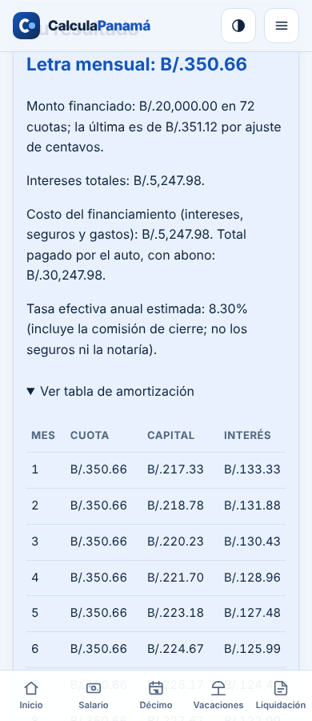

# CP-EXP-001 — Primera expansión de Calcula Panamá

Autorizado por: CEO de Blue Lab Studios. Objetivo: pasar de 12 a 25 herramientas en tres bloques.

| Bloque | Herramientas | Estado |
|---|---|---|
| A — Automóviles | Financiamiento de autos, combustible por viaje, costo mensual de un auto | **Entregado (este PR)** |
| B — Bancos y teléfonos | Interés simple, interés compuesto, tarjetas de crédito, plazo fijo, financiamiento de celulares, datos móviles | Pendiente |
| C — Hogar, compras y prima | Agua, aire acondicionado, gastos diarios, prima de antigüedad | Pendiente |

Herramientas en el directorio tras el bloque A: **15** (12 + 3). CP-SEO-001 queda pendiente para después de la expansión.

## Bloque A — auditoría previa

Base: `main` en `35016d6`. No existe ninguna herramienta de automóviles ni de combustible en `main`, en las ramas remotas ni en los PR abiertos (#35, #34, #33, #32, #19, #6). Se reutiliza la plataforma de la expansión 3 sin rediseñarla y sin dependencias nuevas.

## Arquitectura (reutilización)

- **Motores puros** en `src/lib/tools/calculations.ts`: `carFinancing`, `effectiveAnnualRate`, `fuelTrip`, `kmPerLiter` y `carMonthlyCost`. El financiamiento reutiliza el motor de amortización francesa existente (`src/lib/finance/loans.ts`, `calculateLoan`) en vez de duplicarlo; la validación usa `bounded`, `decimal` y la conversión a centésimos ya existentes.
- **Catálogo** `vehicleTools` en `src/data/expansion-tools.ts`, con el mismo tipo `Tool`. Se añadieron dos campos opcionales: `faq` (preguntas frecuentes, renderizadas con el componente `Faq` existente y su JSON-LD `FAQPage`) y `checkedOn` (fecha de consulta de fuentes). Las cinco herramientas anteriores no cambian.
- **Plantilla** `ToolLayout.astro`: muestra `faq` si existe y la categoría Vehículos. **Script cliente** compartido con tres casos nuevos; las tablas anchas se desplazan dentro del panel.
- **Páginas** estáticas en `src/pages/vehiculos/`, sin anuncios (misma política `disableAds` y CSP que la expansión 3). Directorio `/herramientas/#vehiculos`, enlace en el pie, sitemap automático y verificador SEO actualizado.

## URLs

| Ruta | Título |
|---|---|
| `/vehiculos/financiamiento-de-auto/` | Calculadora de financiamiento de autos |
| `/vehiculos/combustible-por-viaje/` | Calculadora de combustible por viaje |
| `/vehiculos/costo-mensual-de-un-auto/` | Calculadora del costo mensual de un auto |

Cada página tiene título y descripción propios, un H1, instrucciones, fórmula, ejemplo verificable, límites, fuentes, preguntas frecuentes, herramientas relacionadas, canonical en `https://calculapanama.com`, BreadcrumbList y entrada en `sitemap.xml` y `sitemap-0.xml`.

## Fórmulas y casos verificados

Los valores esperados de `tests/automoviles.test.ts` se generaron con una implementación de referencia independiente en Python (aritmética decimal, redondeo half-up).

| Herramienta | Caso | Resultado |
|---|---|---|
| Financiamiento | B/.25,000 − B/.5,000 de abono, 8% nominal, 72 meses | Letra B/.350.66; intereses B/.5,247.98; última cuota B/.351.12 |
| Financiamiento | Igual, con seguros B/.60/mes, comisión B/.300 y notaría B/.150 | Total B/.35,017.98; tasa efectiva 8.89% (8.30% sin comisión) |
| Combustible | 100 km ida y vuelta, 12 km/l, B/.1.25/l, 2 personas | 16.67 l (4.40 gal), B/.20.83, B/.10.42 por persona |
| Combustible | 50 km, 30 mpg, B/.4.80/galón | 3.92 l, B/.4.97 |
| Costo mensual | Gastos del ejemplo de la página, 1,200 km/mes | B/.926.67/mes, B/.11,120/año, B/.776.67 sin depreciación, B/.0.772/km |

Decisiones: interés mensual redondeado al centésimo con ajuste en la última cuota (igual que la calculadora de préstamos); tasa efectiva = TIR mensual de los pagos con la comisión de cierre, anualizada como (1 + i)^12 − 1; galón de EE. UU. = 3.785411784 l y milla = 1.609344 km exactos.

## Fuentes (consultadas el 25 de noviembre de 2026)

- **Superintendencia de Bancos, Acuerdo 3-2002**: define tasa nominal y efectiva; la efectiva es una TIR que incluye comisiones de cierre y excluye seguros, notaría, registro, FECI y tributos. PDF descargado y leído.
- **Superintendencia de Bancos, Acuerdo 6-2026**: el banco debe entregar el desglose de cada cuota en capital, intereses y otros cargos, y el saldo antes y después de cada pago. PDF descargado y leído.
- **Secretaría Nacional de Energía, Resolución MIPRE-2026-0034986** (Gaceta Oficial 30603-A, 2 de septiembre de 2026): precios máximos **por litro** por localidad, actualizados cada 14 días, con factor 1 galón = 3.785412 l. PDF leído mediante la herramienta de lectura web.
- **NIST Handbook 44**, apéndice C: conversiones exactas (ya citado por la expansión 3).

No se incorporó ninguna tasa bancaria, precio de combustible, tarifa de seguro, placa o peaje: todos los importes los escribe la persona usuaria y la herramienta lo indica.

## Verificación

- `npm test`: 188 pruebas (29 nuevas del bloque A).
- `npm run check`: 0 errores (2 avisos previos de `execCommand`, ajenos al bloque).
- `npm run build` con `SITE_URL=https://calculapanama.com/`: correcto; sitemap con 26 URL.
- `npm run verify:seo`: correcto, incluidas las tres rutas nuevas sin AdSense.
- `npx playwright test`: 82 pruebas e2e (10 nuevas: metadatos, directorio, FAQ, cálculos, errores, anchos 320/390/1440 px y sin JavaScript).

