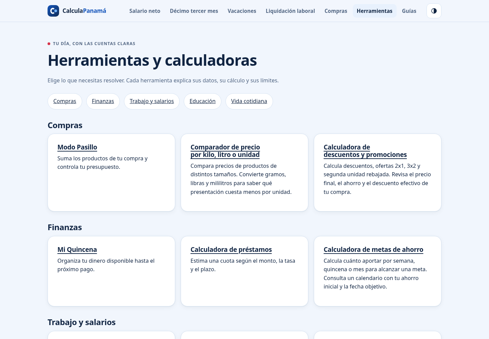
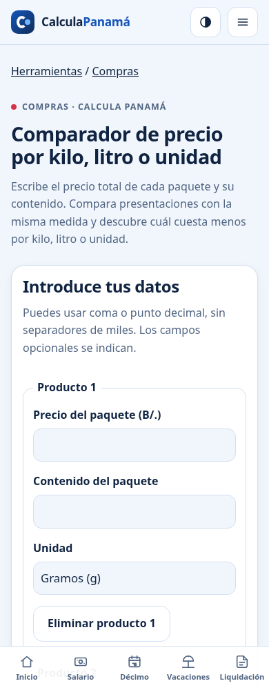
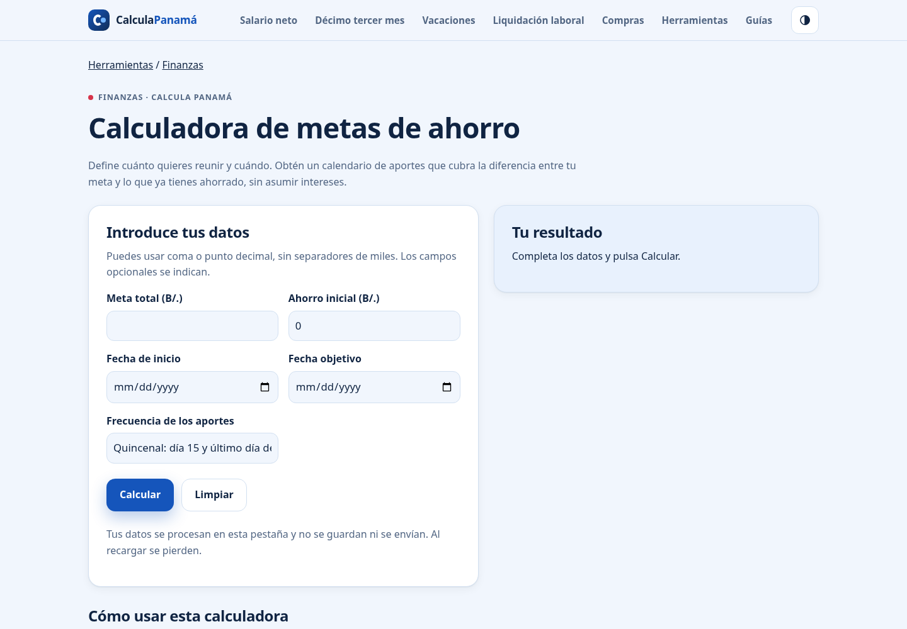

# Calcula Panamá 3.0 — primera expansión

Entrega para revisión, 16 de noviembre de 2026. No fusionar ni desplegar sin aprobación de Dirección.

## Auditoría previa

Base: `main` en `3b7c05e`. Se inspeccionaron páginas Astro, motores existentes, estilos, navegación, sitemap, pruebas, ramas remotas y los seis PR abiertos. No se encontraron implementaciones de las cinco herramientas autorizadas. Las siete herramientas existentes conservan rutas y motores.

PR abiertos al revisar: #35 descubrimiento de liquidación; #34 Responde; #33 validación laboral; #32 privacidad; #19 interacción de Blue; #6 marca. Ninguno se fusionó ni se incorporó a esta rama. Las propuestas editoriales de Responde no duplican estas calculadoras interactivas.

## Arquitectura y alcance

- `src/lib/tools/calculations.ts`: cinco motores puros, sin DOM, almacenamiento ni red.
- `src/data/expansion-tools.ts`: catálogo tipado, campos, contenido editorial, fuentes y enlaces.
- `src/layouts/ToolLayout.astro` y `src/components/tools/ToolField.astro`: plantilla reutilizable y campos accesibles.
- `src/scripts/expansion-tools.ts`: adaptación DOM; resultados mediante `textContent`; validación, filas dinámicas y calendario.
- Cinco páginas Astro estáticas: HTML rastreable, una intención por URL. Sin calculadoras duplicadas ni rutas alternativas.
- `/herramientas/`: doce herramientas agrupadas en cinco categorías. Enlace global al directorio y categorías en el pie. Ajuste de espaciado del menú entre 900 y 1099 px para evitar desbordamiento.
- Sin dependencias nuevas, APIs, cuentas, anuncios nuevos ni persistencia. Las páginas nuevas usan la opción existente `disableAds`, incluyendo su CSP. No se modifica la política publicitaria de páginas anteriores.

Para añadir otra herramienta: definir motor puro y pruebas, incorporar datos al catálogo, crear una página envolvente, integrar la adaptación de su interfaz y actualizar el directorio y pruebas SEO. No crear una página por variación de palabras clave.

## Reglas matemáticas y casos verificables

| Herramienta | Ejemplo | Decisiones y límites |
|---|---|---|
| Precio por unidad | 500 g / B/.2 → B/.4/kg; 750 g / B/.2.70 → B/.3.60/kg | Masa, volumen y unidades son dimensiones incompatibles. Libra internacional = 0.45359237 kg. De 2 a 20 productos. |
| Promociones | Tres unidades de B/.6 en 3x2 → B/.12; 20% y luego 10% sobre B/.100 → B/.72 | Igual precio por artículo. Grupos incompletos a precio normal. Total redondeado al centésimo. No presupone impuestos ni condiciones comerciales. |
| Meta de ahorro | B/.600 menos B/.120, enero–junio 2027 → 12 aportes de B/.40 | Quincenas: 15 y fin de mes. Semanas: cada 7 días desde inicio. Mes: mismo día inicial, ajustado a fin de mes. Reparto de centésimos exacto; máximo 600 aportes. Sin intereses. |
| Promedio de notas | 80 × 40% + 90 × 60% = 86 | Pesos acumulados hasta 100%. Diferencia promedio actual, puntos acumulados y nota necesaria. No presume reglamentos escolares ni nota de aprobación. |
| Consumo eléctrico | 100 W × 5 h × 30 días / 1000 = 15 kWh | Precio opcional introducido por usuario. B/.0.20/kWh es solo ejemplo hipotético. No factura oficial, subsidios, bloques ni cargos fijos. |

Se rechazan vacíos obligatorios, NaN, infinito, exponentes, negativos, separadores de miles, rangos excesivos y fracciones donde se requieren enteros. Se aceptan coma o punto decimal. Los límites están visibles en cada página. Al editar se elimina cualquier resultado anterior. El botón de cálculo permanece deshabilitado si no arranca JavaScript.

## Fuentes

Consultadas el 2026-11-16, enlazadas en cada herramienta:

- NIST, Handbook 44 (2026), apéndice C: conversiones de unidades. PDF recuperado mediante consulta web; la descarga HTTP automatizada directa respondió 403.
- SEP, Aprende en Casa, «Cálculo de porcentajes»: porcentajes y descuentos. Página recuperada y revisada. Las promociones por grupos y descuentos sucesivos se derivan matemáticamente bajo los supuestos publicados.
- CFPB, «Su dinero, sus metas»: planificación de metas de ahorro. PDF disponible (HTTP 200). El calendario exacto y reparto de centésimos son decisiones explícitas de esta herramienta.
- LibreTexts, Cálculo activo, sección 6.3: ejemplo de promedio ponderado de notas y suma de pesos. Página recuperada y revisada. No se usa como reglamento panameño.
- ENSA, «¿Qué es la energía eléctrica?»: potencia por tiempo. Página disponible (HTTP 200).
- ASEP, pliegos tarifarios: referencia de contexto (HTTP 200); no se extrae ni incorpora ninguna tarifa.

Se descartó una referencia de Energy.gov que devolvía 404 y se sustituyeron dos PDFs educativos de acceso inestable por páginas consultables. Las fuentes completas están centralizadas en `src/data/expansion-tools.ts`.

## SEO

| Ruta | Título (más sufijo Calcula Panamá) |
|---|---|
| `/compras/precio-por-unidad/` | Comparador de precio por kilo, litro o unidad |
| `/compras/descuentos-y-promociones/` | Calculadora de descuentos y promociones |
| `/finanzas/meta-de-ahorro/` | Calculadora de metas de ahorro |
| `/educacion/promedio-de-notas/` | Calculadora de promedio de notas y nota necesaria |
| `/vida-cotidiana/consumo-electrico/` | Calculadora de consumo eléctrico en kWh |

Cada ruta tiene metadescripción propia, un H1, instrucciones, fórmula, ejemplo, limitaciones, fuentes, canonical en `https://calculapanama.com` y BreadcrumbList. Ambas salidas sitemap incluyen las rutas y el directorio. El verificador SEO comprueba contenido estático, unicidad y enlaces desde el directorio. No se afirma indexación, tráfico ni posición en Google. No se añadieron FAQ o reseñas ficticias al marcado.

## Verificación reproducible

```sh
npm ci
npm run check
npm test
npm run build
npm run verify:seo
CHROMIUM_PATH=/usr/bin/chromium npm run test:e2e
```

En CI se instala Chromium con Playwright y no se necesita `CHROMIUM_PATH`.

La cobertura nueva verifica cálculos, redondeo, fechas bisiestas, meses cortos, unidades incompatibles, promociones incompletas, metas alcanzadas, límites, notas imposibles, entradas inválidas, resultados obsoletos, agregar/quitar filas, formularios sin JavaScript, canonical, sitemap, enlaces, etiquetas y foco de error. Viewports: 320, 390, 900, 1024 y 1440 px. La suite completa incluye Modo Pasillo y Mi Quincena.

Capturas de las seis páginas a 390 y 1440 px: artefacto de CI `expansion-3-capturas` (retención 14 días). Las vistas seleccionadas de esta carpeta muestran la compilación local; no constituyen una publicación.

## Límites de la revisión

- Pruebas de navegador en Chromium Linux, con tamaños móviles; no en dispositivos físicos, Safari o Firefox.
- Comprobaciones básicas de accesibilidad (etiquetas, foco, mensajes, lectura sin JS y desbordamiento), no certificación WCAG ni evaluación con lector de pantalla.
- No se midieron métricas reales de usuarios ni Search Console.
- Los cálculos son orientativos, no asesoría individual ni importes oficiales.
- Revisión visual/editorial de Dirección pendiente; PR en borrador. No hay autorización de fusión ni despliegue en esta entrega.

## Vistas de la entrega







## Resultados finales locales

- `npm run check`: 0 errores, 0 advertencias; dos sugerencias preexistentes sobre `execCommand` en páginas anteriores.
- `npm test`: 159 pruebas aprobadas (46 nuevas).
- `npm run build`: 24 páginas generadas, incluida 404.
- `npm run verify:seo`: 23 URLs válidas, canonical y robots coherentes.
- `CHROMIUM_PATH=/usr/bin/chromium npm run test:e2e`: 72 pruebas aprobadas, 16 nuevas, incluidas integraciones y regresiones de Modo Pasillo y Mi Quincena.
- `git diff --check`: sin errores.

Se corrigió el desbordamiento a 900 px encontrado en la primera ejecución. La segunda detectó una inconsistencia de lectura de `noscript`; se sustituyó por un aviso HTML visible hasta que arranca el script, manteniendo el botón deshabilitado sin JavaScript. La suite final completa pasó después de esos cambios.
